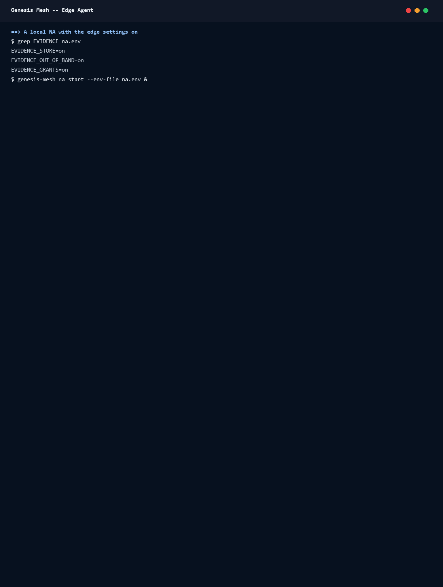

# Walkthrough: Enrolling an Edge Device

This walkthrough enrols one device running the edge agent,
`genesis-mesh-edge`, against a local Network Authority (NA). An application
on the device asks the agent whether it may act; the NA decides. Then the NA
stops, the application makes an urgent change as break-glass, and the record
uploads when the NA is back. The steps follow {doc}`edge-agent`.



The GIF is a real run of `docs/examples/assets/scripts/edge-agent-demo.py`,
recorded on Linux against a throwaway NA on `127.0.0.1:18451`. The
transcript is `docs/examples/assets/images/genesis-mesh-edge-agent.txt`.

## Before you start

The NA needs `EVIDENCE_STORE=on` and `EVIDENCE_OUT_OF_BAND=on`, both off by
default; without them it refuses to create an edge invite
(`409 edge_requires_evidence_store`). Grants on the device also need
`EVIDENCE_GRANTS=on`. The demo turns all three on.

## 1. Keys, a bound invite and enrolment

```bash
genesis-mesh-edge init            # prints the node public key
genesis-mesh admin invite --role client \
  --node-sovereign-id site7-17 --executor-resource-prefix edge:site7-17/ \
  --recipient-key <node public key> > invite-token
genesis-mesh-edge enroll --invite-token-file invite-token
genesis-mesh-edge status
```

The invite is bound to the node key `init` printed, so only this device can
redeem it. `enroll` prints the certificate and the executor key the NA
registered (`edge-…`). `status` shows the certificate's end and that nothing
waits for upload.

The demo then issues an attestation to `site7-17` for the capability
`secret.rotate` and activates a policy that allows `lifetime_days` up to 90.
The GIF does not show that setup.

## 2. The NA decides

With `genesis-mesh-edge run` running, the application asks on the agent's
Unix socket:

```bash
curl --unix-socket /run/genesis-mesh-edge/agent.sock \
  -X POST http://localhost/v1/authorize \
  -d '{"capability": "secret.rotate", "request_parameters": {"lifetime_days": 30},
       "resource_id": "edge:site7-17/kv/db", "resource_action": "rotate"}'
```

The answer is `allowed: true` with `authority: decision`: the NA decided.
The application acts and reports the outcome
(`POST /v1/authorizations/<id>/outcome`), and the agent records the execution
evidence.

## 3. The NA is down: break-glass needs a justification

The demo stops the NA and asks again.

- Without a justification the agent refuses (`justification_required`). The
  device holds no grant for the change.
- With a justification (`"justification": "INC-4471: key leaked in a log,
  rotate now"`) the agent allows it as `authority: break_glass`. The outcome
  is kept as a break-glass record in the outbox, and `/v1/status` shows
  `na_state: unreachable` and one pending upload.

The agent breaks the glass only because the NA could not be reached at all.
An NA that answers with a DENY, a `429` or a `5xx` never leads to
break-glass ({doc}`edge-agent`, *How the agent decides*).

## 4. The NA is back

After the NA restarts, the agent's next sync uploads the record:
`/v1/status` shows `na_state: answering` and no pending uploads. On the NA,
`genesis-mesh admin edge-nodes` lists the device as `online`, with no
pending uploads and one break-glass record. The NA judges that record after
the fact ({doc}`out-of-band-changes`).
