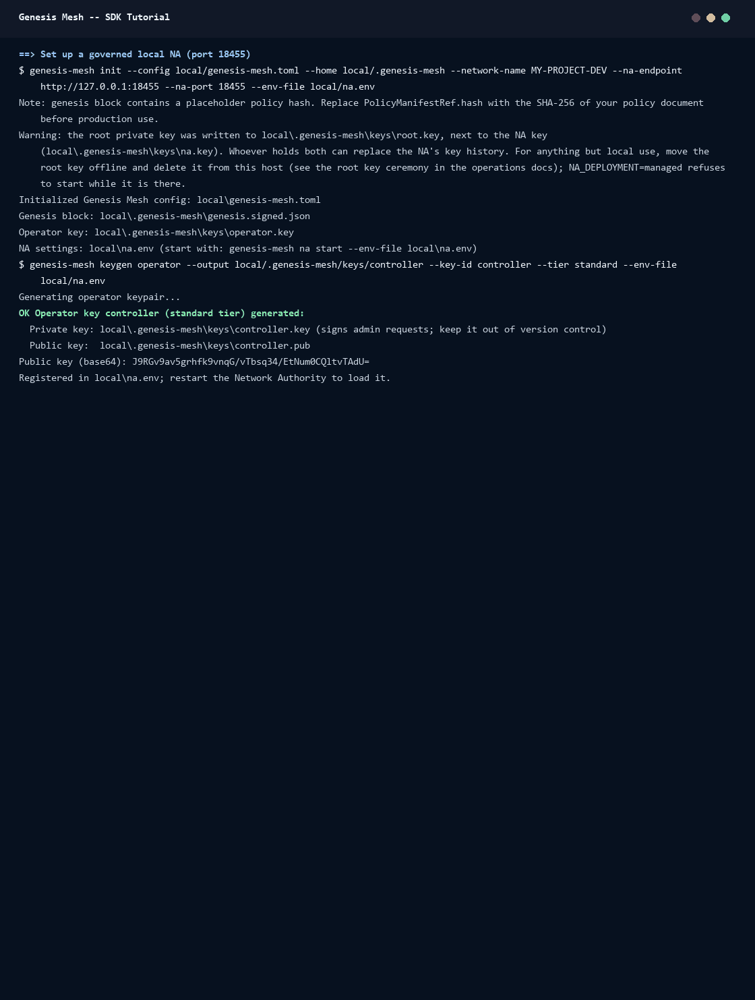

# Tutorial: Build and Verify Trust Evidence

This tutorial uses a Genesis Mesh SDK to have the Network Authority (NA) sign
a trust evidence record, and then checks that record on the public verify
route. The steps show the TypeScript, Go and .NET SDKs; choose your language
in each step.

**What you will build:** a `TrustEvidence` record, the NA's signed statement
of a decision between two sovereigns, and a check of it that anyone can run
without a signing key. The NA signs the decision you submit; it does not
evaluate it. To have the NA decide, use boundary policies
({doc}`sdk/typescript/governance`).

The trust evidence routes (`/admin/trust-evidence` and
`/trust-evidence/verify`) are beta in the {doc}`reference/public-contract`.



## Prerequisites

- A Network Authority running on your machine, set up as in
  {doc}`sdk/local-network-authority`: policies required, the evidence store
  on, and a standard-tier `controller` key. That page uses
  `http://127.0.0.1:9443`.
- The controller key in environment variables. From the directory that
  holds `local/`:

  ```bash
  export GM_ADMIN_KEY_ID=controller
  export GM_ADMIN_KEY_B64=$(grep -v '^#' local/.genesis-mesh/keys/controller.key)
  ```

  The key file holds comment lines and the base64 Ed25519 seed. A standard
  key is enough for this tutorial; keep the privileged `operator-local` key
  for setup.
- To use another address, set `GM_NA_URL`, for example
  `export GM_NA_URL=http://127.0.0.1:8443` for an NA that `genesis-mesh init`
  set up with its default port.
- A language runtime:

::::{tab-set}
:::{tab-item} TypeScript
Node.js 22.18 or later, which runs a `.ts` file directly. On Node.js 22.0 to
22.17, run it with `node --experimental-strip-types`.
:::
:::{tab-item} Go
Go 1.22 or later
:::
:::{tab-item} C#
.NET 8 SDK
:::
::::

## Step 1: Install the SDK

Make a project for the tutorial and add the SDK to it.

::::{tab-set}
:::{tab-item} TypeScript
```bash
mkdir tutorial-ts && cd tutorial-ts
npm init -y
npm pkg set type=module
npm install genesis-mesh-sdk
```
:::
:::{tab-item} Go
```bash
mkdir tutorial-go && cd tutorial-go
go mod init tutorial
go get github.com/GenesisMeshLabs/sdk-go/genesismesh@latest
```
:::
:::{tab-item} C#
```bash
dotnet new console --framework net8.0 -o tutorial-cs && cd tutorial-cs
dotnet add package genesismesh-sdk-dotnet
```
:::
::::

## Step 2: Create an admin client

Admin routes need a signing key: the base64 Ed25519 seed and the key ID the
NA knows it by. Read both from the environment; never put a key in source.

::::{tab-set}
:::{tab-item} TypeScript
In `tutorial.ts`:

```typescript
import { BadRequestError, GenesisMeshClient } from "genesis-mesh-sdk";
import type { TrustDecision } from "genesis-mesh-sdk";

const baseUrl = process.env.GM_NA_URL ?? "http://127.0.0.1:9443";

const client = new GenesisMeshClient({
  baseUrl,
  signingKeyBase64: process.env.GM_ADMIN_KEY_B64,
  keyId: process.env.GM_ADMIN_KEY_ID,
});
```
:::
:::{tab-item} Go
In `main.go`. The code of steps 3 to 5 goes on inside `main`:

```go
package main

import (
	"context"
	"errors"
	"fmt"
	"log"
	"os"

	"github.com/GenesisMeshLabs/sdk-go/genesismesh"
)

func main() {
	ctx := context.Background()

	baseURL := os.Getenv("GM_NA_URL")
	if baseURL == "" {
		baseURL = "http://127.0.0.1:9443"
	}

	client, err := genesismesh.NewClient(genesismesh.ClientOptions{
		BaseURL:    baseURL,
		SigningKey: os.Getenv("GM_ADMIN_KEY_B64"),
		KeyID:      os.Getenv("GM_ADMIN_KEY_ID"),
	})
	if err != nil {
		log.Fatal(err)
	}
```
:::
:::{tab-item} C#
In `Program.cs`:

```csharp
using GenesisMesh;

var baseUrl = Environment.GetEnvironmentVariable("GM_NA_URL") ?? "http://127.0.0.1:9443";

using var client = new GenesisMeshClient(new ClientOptions
{
    BaseUrl    = baseUrl,
    SigningKey = Environment.GetEnvironmentVariable("GM_ADMIN_KEY_B64"),
    KeyId      = Environment.GetEnvironmentVariable("GM_ADMIN_KEY_ID"),
});
```
:::
::::

The client reads the NA's public key from `/sovereign.json` the first time it
signs: admin signatures (version 2) name it as their audience.

## Step 3: Build trust evidence for a decision

A trust decision names a source and a target sovereign and a `verdict`, which
must be `allow`, `block`, `escalate` or `warn`. `source_sovereign_id` and
`target_sovereign_id` are required; the reason, roles, signals and trust path
are optional. The NA signs the decision with its own key and returns the
`TrustEvidence` record.

::::{tab-set}
:::{tab-item} TypeScript
```typescript
const decision: TrustDecision = {
  source_sovereign_id: "ALPHA-NA",
  target_sovereign_id: "BETA-NA",
  verdict: "allow",
  reason: "Recognition treaty active, attestation valid",
};

const evidence = await client.evidence.build({ decision });

console.log(evidence.evidence_id); // a UUID
console.log(evidence.verdict);     // "allow"
console.log(evidence.issued_at);   // ISO 8601 timestamp
```
:::
:::{tab-item} Go
```go
	decision := genesismesh.TrustDecision{
		SourceSovereignID: "ALPHA-NA",
		TargetSovereignID: "BETA-NA",
		Verdict:           "allow",
		Reason:            "Recognition treaty active, attestation valid",
	}

	evidence, err := client.Evidence.Build(ctx, decision)
	if err != nil {
		log.Fatal(err)
	}

	fmt.Println(evidence.EvidenceID) // a UUID
	fmt.Println(evidence.Verdict)    // "allow"
	fmt.Println(evidence.IssuedAt)   // ISO 8601 timestamp
```
:::
:::{tab-item} C#
```csharp
var decision = new TrustDecision
{
    SourceSovereignId = "ALPHA-NA",
    TargetSovereignId = "BETA-NA",
    Verdict           = "allow",
    Reason            = "Recognition treaty active, attestation valid",
};

var evidence = await client.Evidence.Build(decision);

Console.WriteLine(evidence.EvidenceId); // a UUID
Console.WriteLine(evidence.Verdict);    // "allow"
Console.WriteLine(evidence.IssuedAt);   // ISO 8601 timestamp
```
:::
::::

The record carries the decision's fields (source, target, verdict, reason,
roles, signals, hop count), the digest of the NA's recognition graph, the
issuer, `issued_at`, `issued_by` (the NA's key ID) and the NA's Ed25519
signature. Pass it to anyone who needs to check it.

## Step 4: Verify the evidence

The verify route is public: it needs no signing key. Use a second client
without a key, or the same one.

::::{tab-set}
:::{tab-item} TypeScript
```typescript
const publicClient = new GenesisMeshClient({ baseUrl });

const result = await publicClient.evidence.verify({ evidence });

console.log(result.accepted); // true
console.log(result.reason);   // "accepted"
```
:::
:::{tab-item} Go
```go
	publicClient, err := genesismesh.NewClient(genesismesh.ClientOptions{
		BaseURL: baseURL,
	})
	if err != nil {
		log.Fatal(err)
	}

	result, err := publicClient.Evidence.Verify(ctx, map[string]interface{}{
		"evidence": evidence,
	})
	if err != nil {
		log.Fatal(err)
	}

	fmt.Println(result.Accepted) // true
	fmt.Println(result.Reason)   // "accepted"
```
:::
:::{tab-item} C#
```csharp
using var publicClient = new GenesisMeshClient(new ClientOptions
{
    BaseUrl = baseUrl,
});

var result = await publicClient.Evidence.Verify(new Dictionary<string, object?>
{
    ["evidence"] = evidence,
});

Console.WriteLine(result.Accepted); // True
Console.WriteLine(result.Reason);   // "accepted"
```
:::
::::

The NA answers `accepted`, `reason`, `evidence_id`, `issuer_sovereign_id` and
`verdict`. When the record is not accepted, `reason` says why:
`missing_signature`, `invalid_signature` or `graph_digest_mismatch` (the last
only when you pass `expected_graph_digest`). Without `issuer_public_keys`, the
NA checks the signature against its own key that was valid at the record's
`issued_at`, from its key history, so a record signed before a key succession
still verifies. The Go and .NET `VerifyResult` also sets `Valid` to the same
value as `Accepted`.

## Step 5: Handle errors

The NA refuses a `verdict` outside the allowed set with HTTP 400 and the code
`invalid_verdict`. The SDKs raise their 400 error type for it.

::::{tab-set}
:::{tab-item} TypeScript
```typescript
try {
  await client.evidence.build({
    decision: {
      source_sovereign_id: "ALPHA-NA",
      target_sovereign_id: "BETA-NA",
      verdict: "trusted", // not in the allowed set
      reason: "testing",
    },
  });
} catch (err) {
  if (err instanceof BadRequestError) {
    console.error(err.status, err.code, err.message);
    // 400 invalid_verdict verdict must be one of: allow, block, escalate, warn
  } else {
    throw err;
  }
}
```
:::
:::{tab-item} Go
```go
	_, err = client.Evidence.Build(ctx, genesismesh.TrustDecision{
		SourceSovereignID: "ALPHA-NA",
		TargetSovereignID: "BETA-NA",
		Verdict:           "trusted", // not in the allowed set
		Reason:            "testing",
	})

	var bre *genesismesh.BadRequestError
	if errors.As(err, &bre) {
		fmt.Println(bre.Status, bre.Code, bre.Message)
		// 400 invalid_verdict verdict must be one of: allow, block, escalate, warn
	} else if err != nil {
		log.Fatal(err)
	}
}
```
:::
:::{tab-item} C#
```csharp
try
{
    await client.Evidence.Build(new TrustDecision
    {
        SourceSovereignId = "ALPHA-NA",
        TargetSovereignId = "BETA-NA",
        Verdict           = "trusted",  // not in the allowed set
        Reason            = "testing",
    });
}
catch (BadRequestException ex)
{
    Console.WriteLine($"{ex.Status} {ex.Code} {ex.Detail}");
    // 400 invalid_verdict verdict must be one of: allow, block, escalate, warn
}
```
:::
::::

The other input errors of this route are also 400: `missing_decision` and
`invalid_decision` (a missing source or target sovereign ID). A key the NA
does not accept is `401 admin_auth_failed`.

## Run it

With the NA running and the variables from the prerequisites set:

::::{tab-set}
:::{tab-item} TypeScript
```bash
node tutorial.ts
```
:::
:::{tab-item} Go
```bash
go run .
```
:::
:::{tab-item} C#
```bash
dotnet run
```
:::
::::

Each prints the evidence ID, `allow`, the time it was issued, `true`,
`accepted`, and then the `invalid_verdict` refusal. The recording at the top
of this page is a run of these three programs against a local NA on port
18455. The programs and the script that records them are in
`docs/examples/assets/scripts/sdk-tutorial/`.

## What's next

- {doc}`sdk/typescript/sub-clients`, {doc}`sdk/go/sub-clients` and
  {doc}`sdk/dotnet/sub-clients`: every method of each SDK
- {doc}`sdk/typescript/governance`: have the NA decide under a boundary
  policy, then act on its decision
- {doc}`operators/quickstart`: set up a sovereign from scratch
- {doc}`concepts/glossary`: the protocol terms used above
